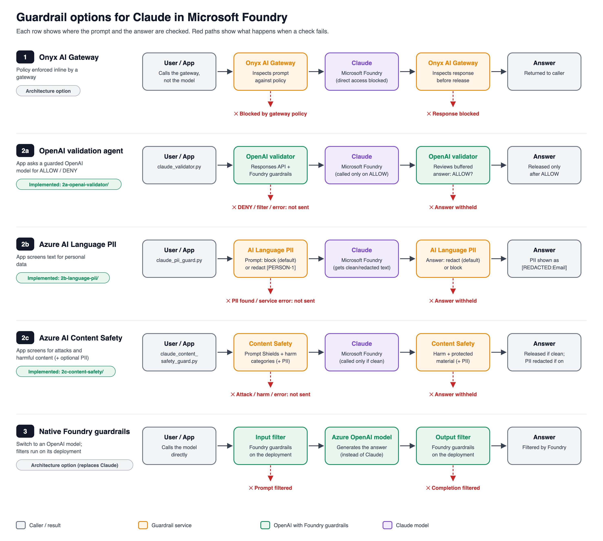

# Guardrail options for Claude in Microsoft Foundry

Four options keep Anthropic Claude as the model that answers the user. The fifth switches to an OpenAI model so Foundry can enforce guardrails on the deployment that generates the answer. **Options 2a, 2b, and 2c are runnable proofs of concept**; options 1 and 3 are architecture choices.



[View the diagram as scalable SVG](docs/architecture.svg).

## Side-by-side comparison

| Decision criterion | 1. Onyx AI Gateway | 2a. OpenAI validation agent | 2b. Azure AI Language | 2c. Azure AI Content Safety | 3. Native Foundry guardrails |
| --- | --- | --- | --- | --- | --- |
| Model that answers | Claude | Claude | Claude | Claude | A supported Azure OpenAI model replaces Claude. |
| What is enforced, and where? | Gateway policies shared across applications routed through Onyx. | The app allows or denies the Claude call based on the validator's decision. Foundry filters the OpenAI call, not Claude. | The app blocks or redacts detected personally identifiable information (PII). It does not check for other content risks. | The app blocks prompt attacks, harmful content, and blocklist matches, and withholds answers with harmful or protected material. It cannot redact. It can also run the 2b PII screen. | Foundry applies the configured filters directly to the answering deployment. Default filters should not be assumed to redact PII. |
| Who inspects the original text? | Onyx sees the prompts and responses it inspects. | The OpenAI validator sees the prompt and, if checked, Claude's answer. | Azure AI Language sees the original prompt before any redaction and the original answer before release. | Content Safety sees the original prompt, any supplied documents, and the answer. With PII enabled, Azure AI Language sees them too. | The answering OpenAI deployment receives the prompt; the app does not send a copy to a separate validator. |
| Cost and latency drivers | Gateway processing on the request and response paths; confirm vendor pricing. | One extra model call for input validation; a second if the answer must also be checked. | A Language scan before generation and another before release; long texts can require multiple requests. | Up to two classifier calls before generation and two before release, per 10,000-character chunk; plus the 2b calls if PII is enabled. No extra model call. | One model call from the app with filtering on the deployment; no separate validation call. |
| What to verify before adoption | Confirm Foundry endpoint compatibility and prevent direct calls that bypass the gateway. | Test incorrect allow/deny decisions and confirm validator outages never allow unchecked traffic. | Test missed PII and false positives in your languages and data categories. | Test misses and false positives on your data, languages, and region. Harm categories score what text depicts, not what a request asks for. | Confirm filter support on the chosen deployment and compare answer quality against Claude. |

**How to choose:** If Claude must stay, start with **2b** when PII is the specific concern, and add **2c** for prompt attacks and harmful content; 2c can run both checks in one pass. Classifiers do not judge intent, so for policy rules they miss, such as refusing requests for dangerous instructions, evaluate **1** when several applications need the same rules, or **2a** when the application needs its own policy decision. If Claude is optional and native enforcement is the priority, evaluate **3**.

## 1. Enforce policy at the Onyx AI Gateway

Route application requests through Onyx before they reach Claude in Foundry, and route responses back through the gateway before releasing them. This gives administrators one place to enforce policy across applications. Restrict direct access to the model endpoint so callers cannot bypass the gateway.

[Onyx describes inline inspection for Claude Enterprise](https://www.onyx.security/blog/onyx-integrates-with-anthropic-inference-hooks-to-bring-runtime-security-natively-into-claude). That integration is not proof of support for Claude's API on Foundry. Before choosing this design, verify that Onyx supports your Foundry endpoint and authentication method, and test the required policies in both directions, including streamed responses if used.

## 2a. Gate Claude calls with an OpenAI validation agent

Send the proposed prompt to a validation agent backed by an OpenAI deployment with the required Foundry guardrails enabled. The application calls Claude only if Foundry permits the validation call **and** the agent returns an explicit allow decision. Treat a filter block, timeout, or invalid decision as a denial.

The guardrails apply to the **OpenAI call**, not to Claude. [The local validator](./2a-openai-validator/claude_validator.py) buffers Claude's answer and checks it before release. It requires an exact `ALLOW` verdict from a completed review on both calls. Its example policy covers personal contact information, credentials, harmful instructions, and attempted overrides; evaluate it on representative data before relying on it.

## 2b. Screen for PII with Azure AI Language (implemented)

[claude_pii_guard.py](./2b-language-pii/claude_pii_guard.py) uses [Azure AI Language PII detection](https://learn.microsoft.com/azure/ai-services/language-service/personally-identifiable-information/how-to/redact-text-pii) on both sides of the Claude call:

| Stage | Default when PII is detected | Alternative |
| --- | --- | --- |
| Before calling Claude | `INPUT_PII_MODE=block`: reject the prompt without calling Claude. | `redact`: forward the service's redacted text, e.g. `Email [PERSON-1] at [EMAIL-2]`. |
| Before returning the answer | `OUTPUT_PII_MODE=redact`: replace detected spans with labels such as `[REDACTED:Email]`. | `block`: withhold the answer. |

When no PII is detected, the text passes unchanged. A reported screening service failure blocks the prompt or withholds the answer. Azure AI Language receives the original text to perform each check; redaction happens **after** that service sees it. This is a PII control, not a harmful-content or prompt-injection filter; [2c](#2c-screen-for-attacks-and-harmful-content-with-azure-ai-content-safety-implemented) adds those checks and can run this PII screen too.

The [offline PII test](./2b-language-pii/test_offline.py) simulates both services; it demonstrates the application's decisions, not the accuracy of live PII detection. Long text is screened in chunks, so entities spanning a boundary can be missed.

## 2c. Screen for attacks and harmful content with Azure AI Content Safety (implemented)

[claude_content_safety_guard.py](./2c-content-safety/claude_content_safety_guard.py) calls the [Azure AI Content Safety](https://learn.microsoft.com/azure/ai-services/content-safety/overview) text APIs, the same service behind Foundry guardrails, on both sides of the Claude call:

| Stage | Checks | When a check fails |
| --- | --- | --- |
| Before calling Claude | [Prompt Shields](https://learn.microsoft.com/azure/ai-services/content-safety/concepts/jailbreak-detection) for jailbreaks in the prompt and injected instructions in supplied documents; Hate, SelfHarm, Sexual, and Violence severity; optional custom blocklists. | Block; Claude is not called. |
| Before returning the answer | Harm severity and blocklists; [protected material](https://learn.microsoft.com/azure/ai-services/content-safety/concepts/protected-material) (known text such as lyrics or articles) for answers of 110 characters or more. | Withhold the answer. |

`HARM_SEVERITY_THRESHOLD=4` blocks medium and high severity; use `2` to also block low. Content Safety returns verdicts and severities, not spans, so it cannot redact. Set `LANGUAGE_ENDPOINT` to also run the [2b PII screen](./2b-language-pii/claude_pii_guard.py) after the Content Safety checks pass, with the same block and redact modes. A service failure or malformed result blocks the prompt or withholds the answer. If Claude itself refuses, the guard reports that instead of returning an empty answer.

`GuardedClaude.ask(prompt, documents=[...])` screens retrieved documents with Prompt Shields and the harm checks, then sends them to Claude as separate content blocks. The interactive script sends prompts only.

Limits to plan for:

- **Classifiers score content, not intent.** In a live check, a request for weapon-making instructions and a direct threat both scored severity 0, while dehumanizing hate scored Violence 4. Pair 2c with a policy check such as 2a if intent matters.
- **Size:** each call takes up to 10,000 characters, and Prompt Shields takes up to five documents per call. Longer text is screened in chunks, so attacks or harmful content spanning a boundary can be missed.
- **Language and region:** harm categories are trained on eight languages; Prompt Shields and protected material are primarily English. [Feature availability varies by region](https://learn.microsoft.com/azure/ai-services/content-safety/region-availability).
- **Groundedness detection** is a preview that [retires on April 30, 2027](https://learn.microsoft.com/azure/ai-services/content-safety/overview), so it is not used.

The [offline test](./2c-content-safety/test_offline.py) simulates Content Safety, the PII API, and Claude to check decisions, chunking, and fail-closed behavior; it does not measure live detection accuracy.

## 3. Use an OpenAI deployment with native Foundry guardrails

If Claude is not required, call a supported Azure OpenAI model in Foundry directly and configure the required input and output filters on that deployment. The same deployment generates the answer and applies the configured policy, so there is no gateway or second validation agent to coordinate. The application still needs to handle blocked prompts and filtered responses.

Check [Azure OpenAI content filtering](https://learn.microsoft.com/azure/ai-services/openai/concepts/content-filter) for the controls available on the chosen model and deployment. Do not assume default content filters redact PII. Before switching, compare answer quality on representative Claude prompts and verify the specific policy outcomes you need.

## Run the implementations

Each option has its own `.venv` and `requirements.txt`. Run the offline checks from the repository folder; none of the tests requires Azure access:

```sh
2a-openai-validator/.venv/bin/python 2a-openai-validator/test_offline.py
2b-language-pii/.venv/bin/python 2b-language-pii/test_offline.py
2c-content-safety/.venv/bin/python 2c-content-safety/test_offline.py
```

The [2a tests](./2a-openai-validator/test_offline.py) simulate validator decisions, Foundry filter flags, and outages. They check that rejected prompts never reach Claude and that only reviewed answer text reaches the caller; they do not measure a live model's classification accuracy.

The [2a live tests](./2a-openai-validator/test_live.py) send fictitious prompts to your real deployments with no mocks. They are skipped unless you opt in, because each run calls Azure and incurs cost. They use the same `.env` as the validator:

```sh
cd 2a-openai-validator
RUN_LIVE_TESTS=1 .venv/bin/python -m unittest test_live -v
```

They check that safe prompts are allowed, prompts containing contact details, credentials, prompt injection, or harmful requests are denied, and a denied prompt never reaches Claude. `HTTP 400; code='content_filter'` warnings are expected when Foundry's filter blocks a test prompt.

The [2c live tests](./2c-content-safety/test_live.py) work the same way, using the 2c `.env`. They check that safe prompts and answers pass, that a jailbreak, an injected document, and hateful text are flagged, and that a flagged prompt never reaches Claude:

```sh
cd 2c-content-safety
RUN_LIVE_TESTS=1 .venv/bin/python -m unittest test_live -v
```

On a fresh checkout, recreate the environments first (tested with Python 3.13):

```sh
for dir in 2a-openai-validator 2b-language-pii 2c-content-safety; do
  python3 -m venv "$dir/.venv" && "$dir/.venv/bin/python" -m pip install -r "$dir/requirements.txt"
done
```

For **live** runs, copy the [2a template](./2a-openai-validator/.env.example), [2b template](./2b-language-pii/.env.example), or [2c template](./2c-content-safety/.env.example) into a local `.env`. Replace the endpoint and deployment placeholders in the copy. Leave keys empty for Entra ID, and keep them empty if the resource disables key authentication; never put secrets in the example files. Each script loads `.env` from beside the script automatically, regardless of the working directory. Exported variables take precedence.

```sh
# From the repository folder, choose one:
cd 2a-openai-validator  # or: cd 2b-language-pii, cd 2c-content-safety
cp -n .env.example .env
# Edit .env with your settings.
```

Use synthetic data for the first check. The scripts use existing deployments; they do not provision resources, attach a Foundry filter policy, or create Content Safety blocklists.

| Used by | Required environment variables | Authentication |
| --- | --- | --- |
| All | `FOUNDRY_BASE_URL=https://<resource>.services.ai.azure.com/anthropic`, `CLAUDE_DEPLOYMENT=<deployment-name>` | Entra ID via `DefaultAzureCredential`, or `FOUNDRY_API_KEY` |
| 2a | `VALIDATOR_BASE_URL=https://<resource>.openai.azure.com/openai/v1/`, `VALIDATOR_DEPLOYMENT=<responses-compatible-deployment>` | Entra ID, or `VALIDATOR_API_KEY`. Use a deployment supporting the OpenAI Responses API and attach the intended guardrail policy in Foundry first. The SDK appends `/responses` to the base URL. |
| 2b | `LANGUAGE_ENDPOINT=https://<language-resource>.cognitiveservices.azure.com` | Entra ID, or `LANGUAGE_KEY`. A Foundry (AI Services) resource also serves this API at `https://<foundry-resource>.cognitiveservices.azure.com` with the same key. See the [script](./2b-language-pii/claude_pii_guard.py) for PII modes, categories, and API version. |
| 2c | `CONTENT_SAFETY_ENDPOINT=https://<content-safety-resource>.cognitiveservices.azure.com`; optionally `LANGUAGE_ENDPOINT` to add the 2b PII screen | Entra ID (the **Cognitive Services User** role), or `CONTENT_SAFETY_KEY`. A Foundry (AI Services) resource in a [supported region](https://learn.microsoft.com/azure/ai-services/content-safety/region-availability) also serves this API at `https://<foundry-resource>.cognitiveservices.azure.com`. See the [script](./2c-content-safety/claude_content_safety_guard.py) for the severity threshold, blocklists, and feature toggles. 2c imports the PII screener from `2b-language-pii/`, so keep the folders side by side. |

```sh
# From your option folder, run the matching command:
.venv/bin/python claude_validator.py             # 2a
.venv/bin/python claude_pii_guard.py             # 2b
.venv/bin/python claude_content_safety_guard.py  # 2c
```

For 2a, add `--verbose` (or `-v`) to show prompt review, the Claude call, answer review, and block reasons on stderr. These diagnostics omit prompts, answers, raw validator replies, and credentials; they do not enable SDK debug logging.

Validator API failures print a warning even without `--verbose`. It includes the exception type and, when available, the HTTP status, service error code, request ID, and underlying exception type. Raw error messages and response bodies are omitted because they can echo submitted text.

If 2a, 2b, or 2c fails with an SSL `UNEXPECTED_EOF_WHILE_READING` connection error, your network may be dropping TLS 1.3 handshakes. Set `TLS_MAX_VERSION=1.2` in that option's `.env`; certificates are still verified.
